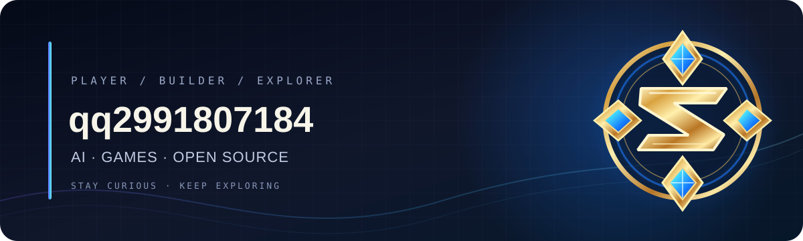

# 你好，我是 qq2991807184 👋

### 🎮 游戏玩家 · 🤖 AI 探索者 · 🧭 开源观察员

把喜欢的东西整理成入口，把新发现变成下一次探索。

---

## ⚡ 快捷启动台

<table>
<tr>
<td width="50%" valign="top">

### 🔥 开源 & AI 雷达

- [GitHub Trending · 今日热门](https://github.com/trending?since=daily) — 看社区正在关注什么
- [GitHub Trending · 本周热门](https://github.com/trending?since=weekly) — 发现持续走热的项目
- [GitHub AI 项目搜索](https://github.com/search?q=AI&type=repositories&s=stars&o=desc) — 按星标探索 AI 仓库
- [Hugging Face · 热门模型](https://huggingface.co/models?sort=trending) — 探索新模型
- [Hugging Face · 热门 Spaces](https://huggingface.co/spaces?sort=trending) — 体验社区 AI 应用
- [Papers with Code](https://paperswithcode.com/) · [arXiv AI](https://arxiv.org/list/cs.AI/recent) — 跟进研究与论文

</td>
<td width="50%" valign="top">

### ⚔️ 英雄联盟 · 数据与资讯

- [英雄联盟官网](https://lol.qq.com/) — 官方公告与游戏入口
- [OP.GG](https://www.op.gg/) — 战绩、英雄与对局数据
- [U.GG](https://u.gg/) — 英雄数据与出装/符文参考
- [LeagueOfGraphs](https://www.leagueofgraphs.com/) — 战绩、统计与排行榜
- [Porofessor](https://porofessor.gg/) — 对局信息与玩家数据（具体功能以服务页面为准）
- [LoL Esports](https://lolesports.com/) — 全球赛事与赛程
- [GitHub 搜索：英雄联盟相关仓库](https://github.com/search?q=%22League+of+Legends%22&type=repositories) — GitHub 仓库搜索
- [GitHub 搜索：疑似英雄联盟作弊软件/脚本](https://github.com/search?q=%22League+of+Legends%22+%28cheat+OR+hack+OR+script%29&type=repositories) — 搜索结果未经核验；请自行判断项目性质、合规性与安全性

</td>
</tr>
<tr>
<td width="50%" valign="top">

### 🎯 三角洲行动 · 资讯与工具探索

- [三角洲行动官网](https://df.qq.com/) — 官方活动、公告与下载入口
- [官方资讯](https://df.qq.com/web202503/news.shtml) — 查看版本与活动消息
- [Steam 社区](https://steamcommunity.com/app/2507950) — 社区讨论与玩家内容
- [Aimlabs](https://store.steampowered.com/app/714010/Aimlabs/) — 免费开始的瞄准训练（可选内购内容以商店说明为准）
- [GitHub 搜索：三角洲行动相关仓库](https://github.com/search?q=%22Delta+Force%22&type=repositories) — GitHub 仓库搜索
- [GitHub 搜索：疑似三角洲行动作弊软件/脚本](https://github.com/search?q=%22Delta+Force%22+%28cheat+OR+hack+OR+script%29&type=repositories) — 搜索结果未经核验；请自行判断项目性质、合规性与安全性

**安全提示：**第三方仓库内容由发布者提供，可能未经验证、含有恶意代码，或违反游戏服务条款；请先审查来源和代码，不要运行不可信程序，也不要提供账号凭据。

</td>
<td width="50%" valign="top">

### 🧰 免费创作与开发入口

- [GitHub Codespaces](https://github.com/features/codespaces) — 在线开发（免费额度与限制见官方说明）
- [GitHub Pages](https://pages.github.com/) — 免费托管静态个人网站
- [Hugging Face Spaces](https://huggingface.co/spaces) — 浏览或创建 AI 演示应用
- [Google AI Studio](https://aistudio.google.com/) — 体验与构建 AI 原型（可用额度以官方页面为准）
- [免安装 Markdown 编辑器](https://stackedit.io/) — 在线编辑 Markdown

> 免费额度、功能与地区可用性可能变化；第三方网站也可能提供付费升级，请以各服务官方说明为准。

</td>
</tr>
</table>

---

## 🌌 我的兴趣坐标

`AI Agents`　`开源模型`　`GitHub Trending`　`英雄联盟数据`　`电竞赛事`　`三角洲行动`　`游戏工具研究`

## 📊 GitHub 数据面板

 

 

 

---

**保持好奇，持续探索。**

[🔥 热门项目](https://github.com/trending) · [🤖 AI 模型](https://huggingface.co/models?sort=trending) · [📦 我的仓库](https://github.com/qq2991807184?tab=repositories)

